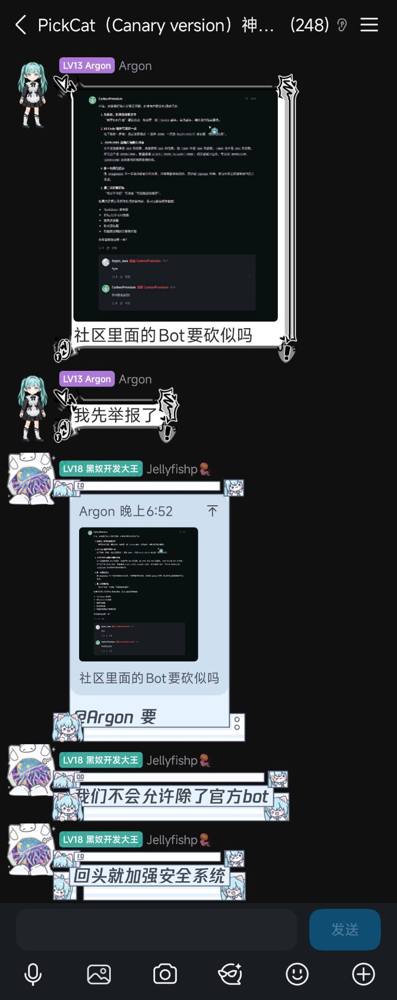

# Pickcat 课代表

基于LLM对Pickcat上帖子的内容进行总结，并把总结内容发送到主题下

## 忠告

鉴于这张截图，以及我的Token余额，我不会长期部署这东西，部署Bot有封号风险，劲大慎用



## 使用

在使用前，你需要配置.env:

```dotenv
PICKCAT_BASE_URL=https://pickcat.dao3.fun # 测试用的 没用
PICKCAT_USERNAME=114514@qq.com # 你的用户名（邮箱或手机号）
PICKCAT_PASSWORD=1919810 # 你的账号的密码
DB_URL=sqlite+aiosqlite:///./data.db #数据库URL,SQLAlchemy格式，要求使用异步驱动
OPENAI_API_KEY=sk-xxx # OpenAI的API Key
OPENAI_BASE_URL=localhost # OpenAI的API 的BaseURL
OPENAI_MODEL=my_brain # 你所使用的模型
```

该项目使用uv来管理依赖，因此你需要uv来构建它

```bash
uv sync
uv run ./src/__main__.py
```

## 存在的问题

- 虽然大量使用async-await 但是并没有任何的`create_task` 因此asyncio的EventLoop永远只会有一个Event 也就是说并没有并发 主要原因是我没想好怎么设计并发
- 由于LLM的不确定性，有时候AI给出的回复会导致API接口返回422(这通常是因为外部链接)

## 协议

基于MIT License开源，使用者被封号与我无关
